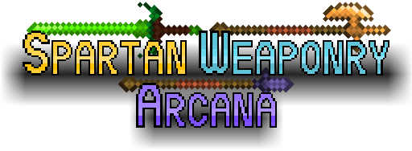
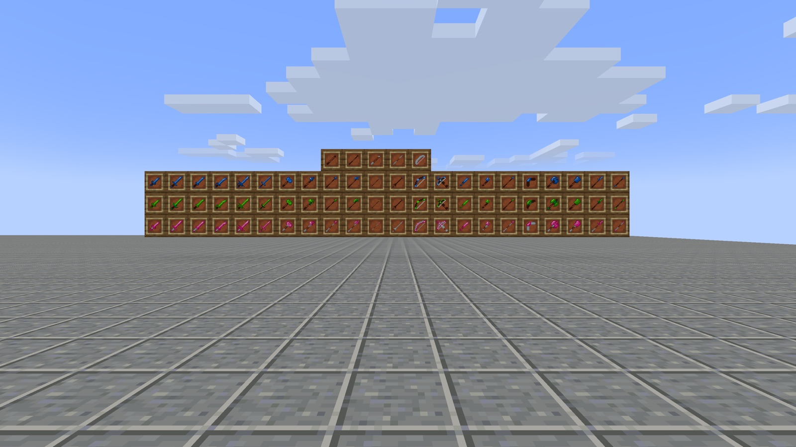
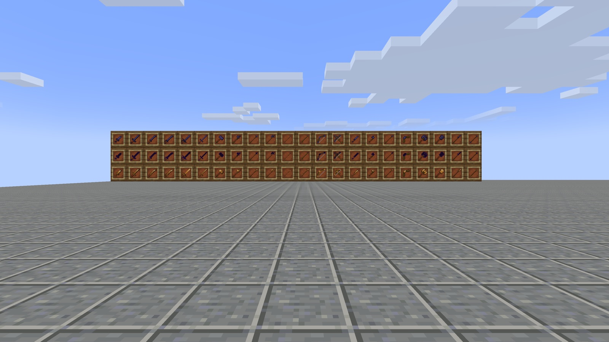
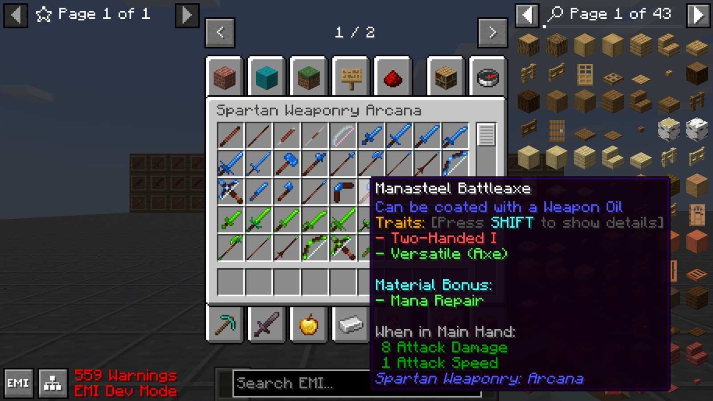
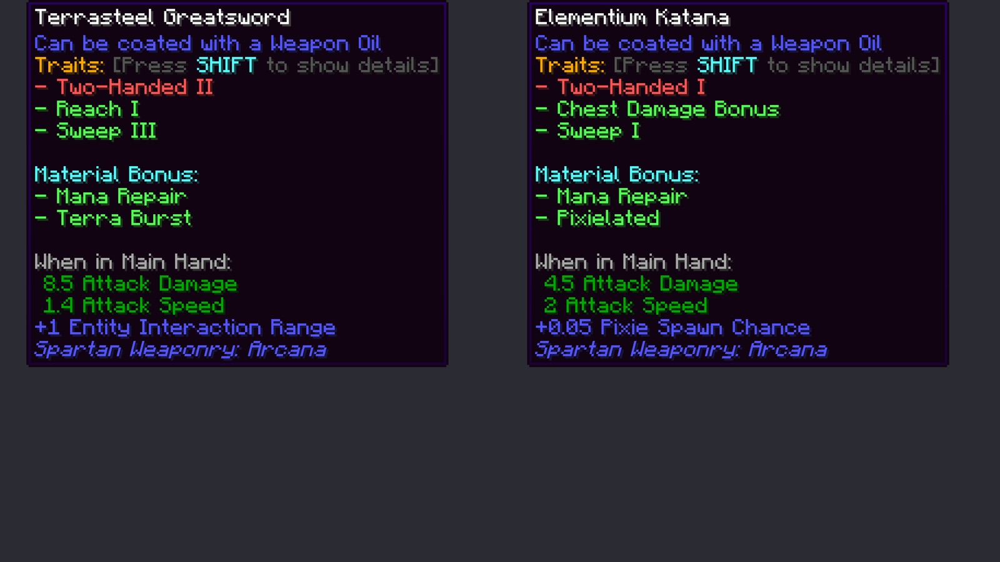
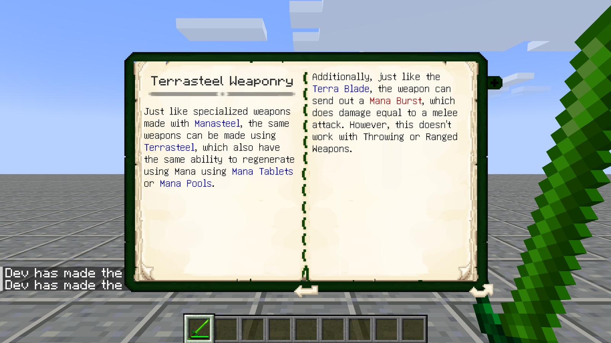
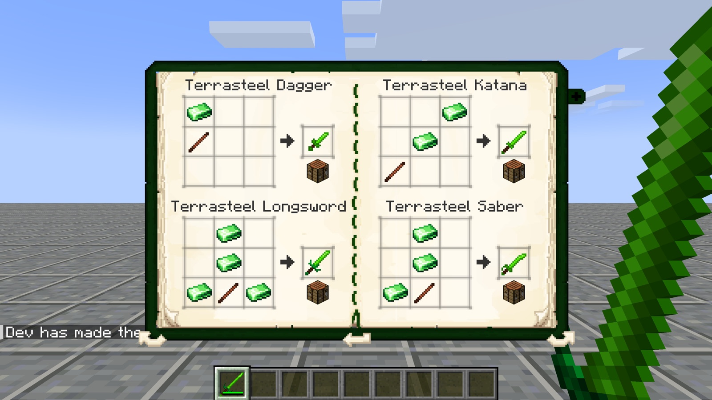

# Spartan Weaponry: Arcana — NeoForge & Fabric 26.3

**Magic metals for the Spartan arsenal**

An unofficial port of **Spartan Weaponry: Arcana** beta-1.0.3 by **ObliviousSpartan** from Minecraft 1.12.2 to
**NeoForge and Fabric 26.3**, as an addon of our [Spartan Weaponry port](https://github.com/Vladeezyy/spartan-weaponry-1.21). This is the
26.3 branch; 1.21.1 (with Botania) is on [`main`](../../tree/main), 1.21.11 on [`mc/1.21.11`](../../tree/mc/1.21.11), 26.1.2 on [`mc/26.1.2`](../../tree/mc/26.1.2), 26.2 on [`mc/26.2`](../../tree/mc/26.2).

---

## ⚔️ About the mod

Arcana adds every Spartan Weaponry weapon type in the metals of magic mods, with the abilities those metals have in
their own mods.

- **132 weapons**: daggers, longswords, katanas, sabers, rapiers, greatswords, battle hammers, warhammers, spears,
  halberds, pikes, lances, longbows, heavy crossbows, throwing knives, tomahawks, javelins, boomerangs, battleaxes,
  flanged maces, glaives and quarterstaves in six materials:

  | Material | From | Ability |
  | --- | --- | --- |
  | **Manasteel** | Botania | **Mana Repair**: repairs itself with mana from Mana Tablets and other mana items in your inventory |
  | **Terrasteel** | Botania | **Mana Repair** and **Terra Burst**: a swing at the air fires a mana burst that deals your melee damage, like the Terra Blade |
  | **Elementium** | Botania | **Mana Repair** and **Pixielated**: a 5 % chance that a pixie defends you when you are hurt |
  | **Thaumium** | any mod with `c:ingots/thaumium` | — |
  | **Void Metal** | any mod with `c:ingots/void_metal` | **Warped**: repairs one durability every second |
  | **Dawnstone** | any mod with `c:ingots/dawnstone` | — |

- **Livingwood and Dreamwood handles and poles**, and a Dreamwood crossbow limb, made from Botania twigs.
- **Botania lexicon**: three entries in the Tools category of the Lexica Botania, with every recipe.
- **Recipes appear with the metal**: a material's weapons are craftable, and shown in the creative tab, JEI and EMI,
  as soon as some mod (or a data pack) adds its ingots to the `c:ingots/<material>` tag. Botania 1.21.1 gives
  Manasteel, Terrasteel and Elementium; Thaumcraft and Embers have no 1.21 versions, so Thaumium, Void Metal and
  Dawnstone wait for a mod that adds those ingots.
- **Languages**: English, Russian, Ukrainian, German, Spanish, Brazilian Portuguese (all but English are new: machine
  translations checked by hand, corrections welcome).

## 📸 Screenshots

  
  
  
  
  
  

## 📦 Requirements

**NeoForge**

- **NeoForge 26.3.0.95** or newer for Minecraft **26.3**.
- **[Spartan Weaponry 3.2.1.2+26.3](https://github.com/Vladeezyy/spartan-weaponry-1.21/releases)** or newer.

**Fabric**

- **Fabric Loader 0.19.5** or newer for Minecraft **26.3**.
- **[Spartan Weaponry 3.2.1.2+26.3](https://github.com/Vladeezyy/spartan-weaponry-1.21/releases)** for Fabric or newer, with what it needs (Fabric API, Forge Config API Port).

Both: required on the client and the server. Optional: **Botania** (Manasteel, Terrasteel, Elementium, the abilities
and the lexicon), any mod adding Thaumium, Void Metal or Dawnstone ingots, **JEI** / **EMI**.
The weapons follow Spartan Weaponry's per-type settings (`config/spartanweaponry-common.toml`: speed, damage,
disabled types).

> **Botania has no 26.3 version**, so this 26.3 build has no Botania integration: the Manasteel, Terrasteel and
> Elementium weapons exist but cannot be crafted, and Mana Repair, Terra Burst, Pixielated and the lexicon entries do
> nothing. The Thaumium, Void Metal and Dawnstone weapons work as soon as a mod or data pack adds their ingots. With no
> such material the creative tab is empty, as in the original. For Botania, use the 1.21.1 version.

## 🔧 What changed in the port

Weapons, stats, textures and recipes are those of beta-1.0.3; ids follow Spartan Weaponry 1.21
(`manasteel_dagger` instead of `dagger_manasteel`). Thaumcraft research, arcane crafting and the warp of Void Metal
weapons are gone with Thaumcraft (no 1.21 version): Thaumium and Void Metal weapons are made on a crafting table.

| Original issue | Fix |
| --- | --- |
| [#5](https://github.com/ObliviousSpartan/SpartanWeaponryArcana/issues/5) Embers weapons are loaded regardless of the mod | The creative tab, JEI and EMI only show the materials some mod provides; recipes need the ingots |
| [#3](https://github.com/ObliviousSpartan/SpartanWeaponryArcana/issues/3) Swinging a Terrasteel weapon on a server kicks the player | Fixed by the new network code; tested with a client on a dedicated server |
| [#4](https://github.com/ObliviousSpartan/SpartanWeaponryArcana/issues/4) No config for the weapons | Spartan Weaponry's per-type settings apply; traits are data |
| [#1](https://github.com/ObliviousSpartan/SpartanWeaponryArcana/issues/1) Crash at start-up with a mismatched Spartan Weaponry | Checked at start-up with a clear message |

Found while porting:

- Void Metal weapons repaired faster with every extra player online, and undamaged ones got a durability of -1.
- Bows and heavy crossbows did not repair with mana (Spartan Weaponry 1.21 gives traits to melee and thrown weapons
  only); every Arcana weapon repairs now, as in 1.12.2.

The full list, with the reasons and what 1.21 changed, is in **[PORTLOG.md](PORTLOG.md)**.

## ✅ Tested

- **Functional** (22 checks on NeoForge 26.3.0.95 and on Fabric Loader 0.19.5 with Fabric API 0.165.0, Spartan Weaponry
  3.2.1.2+26.3): items and their looks, recipes by tag (and a data pack adding Thaumium ingots), the creative tab,
  damage, durability, enchanting table, Warped; a client swinging a Terrasteel greatsword on a dedicated server.
- **Release jar** on a real NeoForge 26.3.0.95 server and a dedicated Fabric server; the scene on a Fabric production
  client.
- **Compatibility**: Sodium 0.9.3 beta, Iris 1.11.7, Lithium 0.26.2, FerriteCore 9.0.0, Jade, JEI 31. On Fabric with the Complementary shaders on; on NeoForge with the shader pack off, as Iris 1.11.7 for
  NeoForge 26.3 crashes in its render passes with a shader pack on (with vanilla content too).
- Not on 26.3: Botania, EMI, ModernFix (no 26.3 versions).

## ❤️ Credits

- **Spartan Weaponry: Arcana** and **Spartan Weaponry** — made by **ObliviousSpartan** ·
  [source](https://github.com/ObliviousSpartan/SpartanWeaponryArcana). All the content, art and ideas are theirs.
- **Botania** by Vazkii and contributors: the Terra Burst follows its Terra Blade.
- **Port** to NeoForge and Fabric 1.21.1, 1.21.11, 26.1.2, 26.2 and 26.3 — [Vladeezyy](https://github.com/Vladeezyy).
- Bugs of **this port**: [issues](../../issues). Please don't report port bugs to the original author.

### License

Like the original, the port is licensed under the **GNU GPL 3.0 or later** ([LICENSE](LICENSE)).
Spartan Weaponry: Arcana © ObliviousSpartan; port © 2026 Vladeezyy.
Forks are welcome: they must stay open, under the same license, and credit the authors.
Please download the mod only from the official pages.

---

<b>🇷🇺 Описание на русском</b>

 

**Магические металлы для спартанского арсенала**

Неофициальный порт мода **Spartan Weaponry: Arcana** beta-1.0.3 от **ObliviousSpartan** с Minecraft 1.12.2 на
**NeoForge и Fabric 26.3** — аддон к нашему [порту Spartan Weaponry](https://github.com/Vladeezyy/spartan-weaponry-1.21). Это ветка 26.3;
1.21.1 (с Botania) — в [`main`](../../tree/main), 1.21.11 — в [`mc/1.21.11`](../../tree/mc/1.21.11), 26.1.2 — в [`mc/26.1.2`](../../tree/mc/26.1.2), 26.2 — в [`mc/26.2`](../../tree/mc/26.2).

<b>⚔️ О моде</b>

Arcana добавляет все виды оружия Spartan Weaponry из металлов магических модов — со способностями, которые у этих
металлов есть в их собственных модах.

- **132 предмета**: кинжалы, полуторные мечи, катаны, сабли, рапиры, двуручные мечи, боевые молоты, клевцы, копья,
  алебарды, пики, турнирные копья, большие луки, тяжёлые арбалеты, метательные ножи, томагавки, метательные копья,
  бумеранги, боевые топоры, перначи, глефы и боевые посохи из шести материалов:

  | Материал | Откуда | Способность |
  | --- | --- | --- |
  | **Манасталь** | Botania | **Починка маной**: чинится маной из мана-планшетов и других предметов с маной в инвентаре |
  | **Террасталь** | Botania | **Починка маной** и **Терра-вспышка**: взмах в воздух выпускает вспышку маны с уроном ближнего боя, как Терра-клинок |
  | **Элементий** | Botania | **Починка маной** и **Пикси**: 5 % шанс, что пикси защитит вас, когда вас ранят |
  | **Таумиум** | любой мод с `c:ingots/thaumium` | — |
  | **Пустотный металл** | любой мод с `c:ingots/void_metal` | **Искажённое**: чинит одну единицу прочности в секунду |
  | **Рассветный камень** | любой мод с `c:ingots/dawnstone` | — |

- **Рукояти и шесты из жизнедерева и дерева мечтаний** и плечо арбалета из дерева мечтаний — из веточек Botania.
- **Лексикон Botania**: три статьи в разделе «Инструменты» со всеми рецептами.
- **Рецепты появляются вместе с металлом**: оружие материала можно скрафтить, и оно видно во вкладке творчества, JEI
  и EMI, как только какой-нибудь мод (или датапак) добавит его слитки в тег `c:ingots/<материал>`. Botania 1.21.1
  даёт манасталь, террасталь и элементий; у Thaumcraft и Embers нет версий для 1.21, поэтому таумиум, пустотный
  металл и рассветный камень ждут мода с такими слитками.
- **Языки**: английский, русский, украинский, немецкий, испанский, бразильский португальский (все, кроме английского,
  новые: машинный перевод, проверенный вручную, правки приветствуются).

<b>📦 Требования</b>

**NeoForge**

- **NeoForge 26.3.0.95** или новее для Minecraft **26.3**.
- **[Spartan Weaponry 3.2.1.2+26.3](https://github.com/Vladeezyy/spartan-weaponry-1.21/releases)** или новее.

**Fabric**

- **Fabric Loader 0.19.5** или новее для Minecraft **26.3**.
- **[Spartan Weaponry 3.2.1.2+26.3](https://github.com/Vladeezyy/spartan-weaponry-1.21/releases)** для Fabric или новее, с тем, что ему нужно (Fabric API, Forge Config API Port).

Для обоих: нужен и на клиенте, и на сервере. По желанию: **Botania** (манасталь, террасталь, элементий, способности и
лексикон), любой мод со слитками таумиума, пустотного металла или рассветного камня, **JEI** / **EMI**.
На оружие действуют настройки Spartan Weaponry по видам оружия (`config/spartanweaponry-common.toml`: скорость,
урон, отключение видов).

> **У Botania нет версии под 26.3**, поэтому в этой сборке нет интеграции с Botania: оружие из манастали,
> террастали и элементия есть, но не крафтится, а починка маной, терра-вспышка, «Пикси» и статьи лексикона не
> работают. Оружие из таумиума, пустотного металла и рассветного камня работает, как только мод или датапак добавит
> их слитки. Без таких материалов вкладка творчества пуста, как в оригинале. Для Botania берите версию 1.21.1.

<b>🔧 Что изменилось в порте</b>

Оружие, характеристики, текстуры и рецепты — как в beta-1.0.3; id как в Spartan Weaponry 1.21 (`manasteel_dagger`
вместо `dagger_manasteel`). Исследования Thaumcraft, тайный верстак и «искажение» (warp) от оружия из пустотного
металла ушли вместе с Thaumcraft (версии для 1.21 нет): оружие из таумиума и пустотного металла делается на верстаке.

- **Оружие Embers загружалось без мода** ([#5](https://github.com/ObliviousSpartan/SpartanWeaponryArcana/issues/5)) —
  вкладка, JEI и EMI показывают только материалы, которые даёт какой-то мод; рецептам нужны слитки.
- **Кик с сервера при взмахе оружием из террастали** ([#3](https://github.com/ObliviousSpartan/SpartanWeaponryArcana/issues/3)) —
  исправлено новой сетевой частью; проверено клиентом на выделенном сервере.
- **Нет настроек оружия** ([#4](https://github.com/ObliviousSpartan/SpartanWeaponryArcana/issues/4)) — действуют
  настройки Spartan Weaponry по видам; особенности материалов задаются данными.
- **Краш при запуске с неподходящей Spartan Weaponry** ([#1](https://github.com/ObliviousSpartan/SpartanWeaponryArcana/issues/1)) —
  версия проверяется при запуске с понятным сообщением.

Найдено при портировании: оружие из пустотного металла чинилось тем быстрее, чем больше игроков онлайн, а целому
ставилась прочность -1; луки и тяжёлые арбалеты не чинились маной — теперь чинится всё оружие Arcana, как в 1.12.2.

Полный список с причинами — в **[PORTLOG.md](PORTLOG.md)** (на английском).

<b>✅ Проверено</b>

- **Функционально** (22 проверки на NeoForge 26.3.0.95 и на Fabric Loader 0.19.5 с Fabric API 0.165.0, Spartan
  Weaponry 3.2.1.2+26.3): предметы и их вид, рецепты по тегам (и датапак со слитками таумиума), вкладка творчества,
  урон, прочность, стол зачарований, «Искажённое»; клиент с двуручным мечом из террастали на выделенном сервере.
- **Release jar** на настоящем сервере NeoForge 26.3.0.95 и на выделенном сервере Fabric; сцена на production-клиенте
  Fabric.
- **Совместимость**: Sodium 0.9.3 beta, Iris 1.11.7, Lithium 0.26.2, FerriteCore 9.0.0, Jade, JEI 31. На Fabric — с шейдерами Complementary; на NeoForge — без шейдерпака: Iris 1.11.7 для NeoForge 26.3 падает в
  своих проходах рендера с включённым шейдерпаком (и на ванильном контенте).
- Нет под 26.3: Botania, EMI, ModernFix.

<b>❤️ Авторы и лицензия</b>

- **Spartan Weaponry: Arcana** и **Spartan Weaponry** — автор **ObliviousSpartan** ·
  [исходники](https://github.com/ObliviousSpartan/SpartanWeaponryArcana). Всё содержимое, графика и идеи — их.
- **Botania** — Vazkii и участники: терра-вспышка повторяет Терра-клинок.
- **Порт** на NeoForge и Fabric 1.21.1, 1.21.11, 26.1.2, 26.2 и 26.3 — [Vladeezyy](https://github.com/Vladeezyy).
- Баги **этого порта**: [issues](../../issues). Пожалуйста, не пишите о багах порта автору оригинала.

Как и оригинал, порт распространяется по **GNU GPL 3.0 или новее** ([LICENSE](LICENSE)).
Spartan Weaponry: Arcana © ObliviousSpartan; порт © 2026 Vladeezyy.
Форки приветствуются: они должны оставаться открытыми, под той же лицензией и с указанием авторов.
Скачивайте мод только с официальных страниц.

